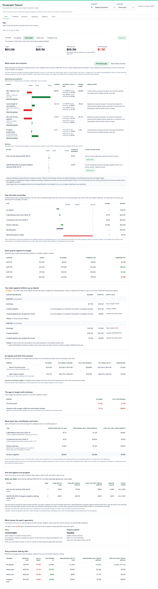
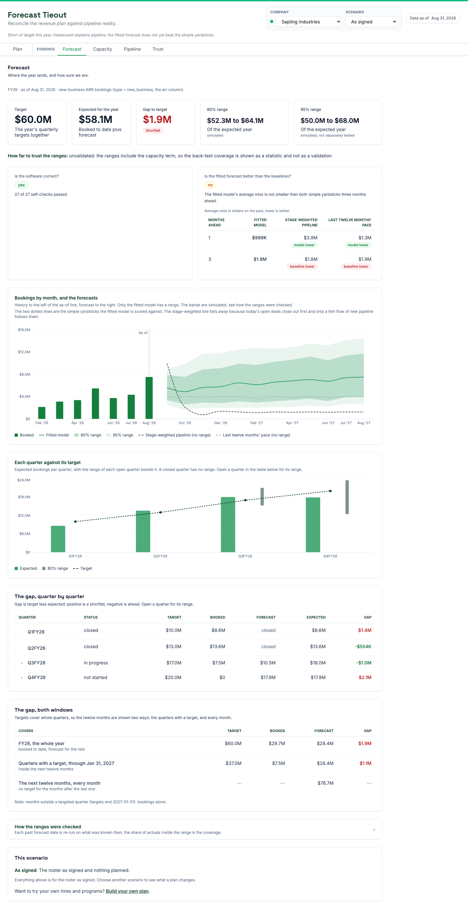
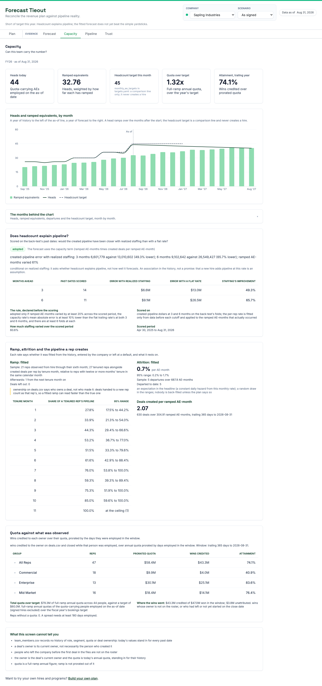
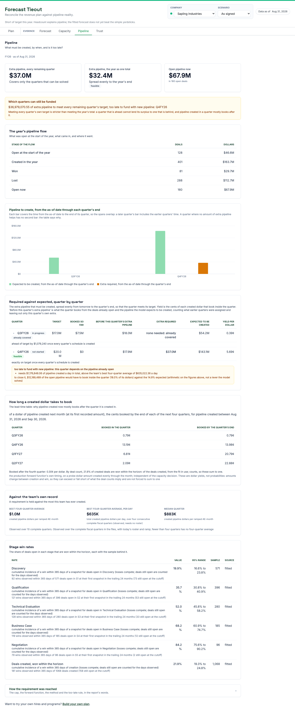
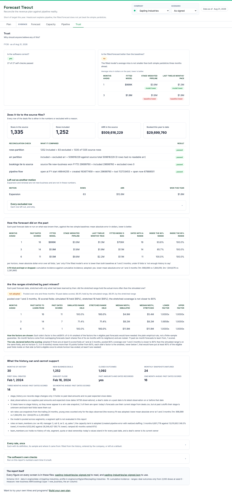

# Forecast Tieout

Reconcile the revenue plan against pipeline reality.



## What it is

Forecast Tieout reads a company's deals, stage history and roster, and writes one
report that ties out: the bookings to date, a forecast for the rest of the year with
its range, the gap to the plan's targets, whether the team has the capacity to close
that gap, what must be created and by when, and what a hiring or program plan buys.
Every figure comes with its sample, its source and its error, and the report checks
itself against the source files before it says anything.

There are two parts. The core, `engine/tieout_core`, is Python: it reads the CSV files
and writes `report.json` and `report.md`. The app, `frontend/`, is a static React site
that draws those reports. The app calculates nothing: every number it shows is a value
in a report file.

**The demo companies are synthetic.** Sprout Labs, Sapling Industries and Mighty Oak
Holdings are generated by `engine/scripts/generate_data_v2.py` from a fixed seed. They
are not real businesses and their numbers say nothing about any real one. The demo's
as-of date is 2026-08-31 and the fiscal year is FY26.

The previous engine and its nine-page app were retired at the git tag `pre-rebuild`.

## The five screens

Each screen answers one question, for one company and one scenario at a time.

| Screen | Question | What it shows |
|---|---|---|
| Forecast (`/forecast`) | Where does the year land, and how sure are we? | Bookings by month; the fitted forecast with 80% and 95% ranges and two baselines marked as point forecasts; the gap by quarter and for both windows; two verdicts |
| Capacity (`/capacity`) | Can this team carry the number? | Heads and ramped equivalents by month; ramp and attrition with their source and sample; whether headcount explains pipeline; quota against observed attainment |
| Pipeline (`/pipeline`) | What must be created, by when, and is it too late? | The year's pipeline flow; required against expected pipeline by quarter; a lead-time table; stage win rates with samples |
| Plan (`/plan`, the landing screen) | What moves the outcome, and which plan do we choose? | The planning worksheet: target, as signed, working plan and remaining gap; the editor in place; a tornado of four operating drivers (at their historical low and high settings) and two actions, with what each needs alone; how the plan reconciles; each quarter; the as-signed top-down against bottom-up chain; then each item's gain and cost, one hire against one program, and every scenario side by side |
| Trust (`/trust`) | Why should anyone believe any of this? | Reconciliation checks and excluded rows; the back-test against two baselines; what the history cannot support; every rate once; links to the report files |

Sapling Industries, as signed (Plan shows the demo plan):






For Sapling Industries as signed, the report says: fiscal-year target $60,000,000,
expected $58,089,724, gap $1,910,276, 80% range $52,336,651 to $64,087,138. Its two
verdicts: the software is correct (20 of 20 self-checks pass), and the fitted forecast
is not better than both baselines (at three months its error is 1,944,676 against
1,776,756 for stage-weighted pipeline). Mighty Oak Holdings' Capacity and Plan screens
say in words that its history cannot support a hiring recommendation.

## The four scenarios

Each company has four complete reports, each computed by the core:

- **As signed**: the roster as signed and nothing planned.
- **Demo plan**: the company's `plan.yaml`, further hires and program pipeline together.
- **Hires only**: the plan's hires alone.
- **Program only**: the plan's program pipeline alone.

Sapling's demo plan, for example, moves the expected year from $58,089,724 to
$58,325,013 and closes $235,289 of the gap, at a cash cost of $791,071 over the next
twelve months. A scenario is chosen with the selector in the header or `?scenario=` in
the address.

## Your own plan (desktop only)

At desktop widths, the Plan screen has a "Build your own plan" button, set apart from the named scenarios: a form of hires and
programs that starts from the company's demo plan. Apply computes a complete report for
it in your browser, with the same Python core that wrote the committed reports (Pyodide in
a web worker), and every screen then shows it, marked as your plan. The first time costs
a download of about 10 MB gzipped (17 MB raw) from this site and a few seconds of start-up;
nothing is fetched before you open the choice, nothing comes from another site, and
nothing is stored or sent. On a phone the choice is absent.

## Run the app

```bash
cd frontend
npm install
npm run dev        # http://localhost:3000
```

The reports are committed under `frontend/public/data/reports/`, so the app needs no
server and no environment variables. `npm run build` writes a static site to
`frontend/dist`, which any static host can serve; `vercel.json` carries the single-page rewrite.

## Run a report on your own files

```bash
pip install -r engine/requirements.txt
python -m engine.tieout_core report \
  --profile engine/config/profiles/your-company \
  --data path/to/your-company-data \
  --as-of 2026-08-31 \
  --out out/your-company \
  [--plan engine/config/profiles/your-company/plan.yaml]
```

This writes `out/your-company/report.md` and `report.json`. The exit status is 0 when
the report's own checks pass, 1 when one fails and 2 when the inputs cannot be read.
`--draws` and `--seed` set the simulation (2000 and 0 by default).

The data directory holds CSV files: `deals.csv` and `stage_history.csv` (required),
`team_members.csv` (needed for the capacity screens) and `deal_observations.csv`
(past amounts and expected close dates; without it the report says what it could not
do). Copy `engine/data-v2/sapling-industries/` for the column names.

The profile directory describes your company: copy one of the three under
`engine/config/profiles/` and edit it.

| File | Controls |
|---|---|
| `stages.yaml` | Stage names, order and the stage probability used for open deals |
| `field_mappings.yaml` | Maps your stage names to the core's stage codes (`opportunity.stage.stage_mapping`) |
| `targets.yaml` | Fiscal-year start and the quarterly bookings targets |
| `capacity.yaml` | Which roles carry quota, and ramp, attrition and cost where your history cannot supply them (optional) |
| `plan.yaml` | Further hires and program pipeline, passed with `--plan` (optional) |

Rows the core cannot read are not dropped silently: each is listed on the Trust screen
with its reason, and a check fails if included and excluded rows do not add up to the
source.

To regenerate the committed app data after changing a profile, a plan or the core:

```bash
python -m engine.scripts.generate_app_reports
```

## How the screens stay honest

Every business value on a screen is rendered through one component that is given a
binding: the scenario, a path into the report, and a named format (full dollars,
abbreviated dollars, percent, count, date, or verbatim text). The browser formats and
draws; it does not add, subtract or divide. The report's decimals are strings that only
the formatter and the chart adapter can parse, and a test scans `frontend/src` for
arithmetic. A missing figure is shown in words with its reason, never as zero.

The tests then check, for every screen, company and scenario: that every binding on the
screen's committed list is present and shows the value an independently written
expectation derives from the report; that no digit appears outside a bound element
except on chart axes and period labels; that each chart draws exactly its bound series;
and that swapping a path, a company, a scenario or a sign makes a test fail.

`python -m engine.scripts.generate_app_reports --verify` keeps the data honest. It
regenerates every report file, the comparison files, the scenario plan files, the JSON
Schema and the TypeScript types into a temporary directory and compares them byte for
byte with what is committed. It fails on any difference, on any report that does not
validate against the schema, and on any report whose "software is correct" verdict is
not yes. CI runs it on every push.

## Tests

Install `engine/requirements-dev.txt` first, so the linter and test runner match CI.

```bash
python -m pytest engine/tests/ -n auto                                  # the core, the generators, the report contract
python -m engine.scripts.generate_data_v2 --verify              # the demo data is what the generator writes
python -m engine.scripts.generate_app_reports --verify          # the committed reports are what the core writes
python -m engine.scripts.generate_editor_fixture --verify       # the plan editor's expected result is what a native run writes
ruff check engine/tieout_core engine/tests/tieout_core engine/scripts/synth_history.py engine/scripts/generate_data_v2.py engine/scripts/generate_app_reports.py
cd frontend
npx tsc --noEmit
npm run verify                                                  # dead-code check (knip), then the unit tests
npm run build
npx playwright install chromium && npx playwright test --grep @smoke   # the built app in a real browser
npm run screenshots                                             # rewrites the images in docs/screenshots
```

See [ARCHITECTURE.md](ARCHITECTURE.md) for how the parts fit together.

## License

Apache 2.0. See [LICENSE](LICENSE).

The app bundles two typefaces through fontsource, both under the SIL Open Font License 1.1: Inter (latin subset, three weights) and Space Grotesk. The font files are in the built site, not fetched from a third party.
